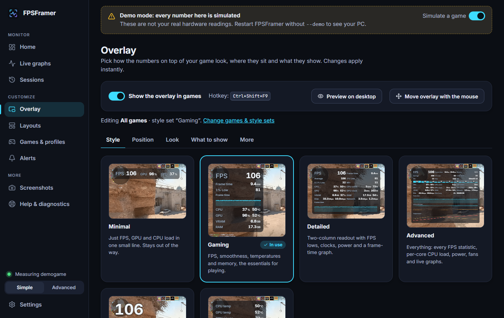
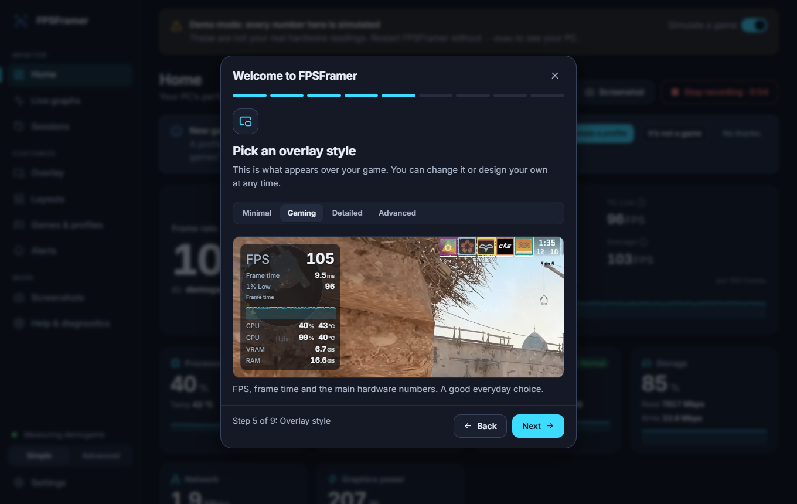
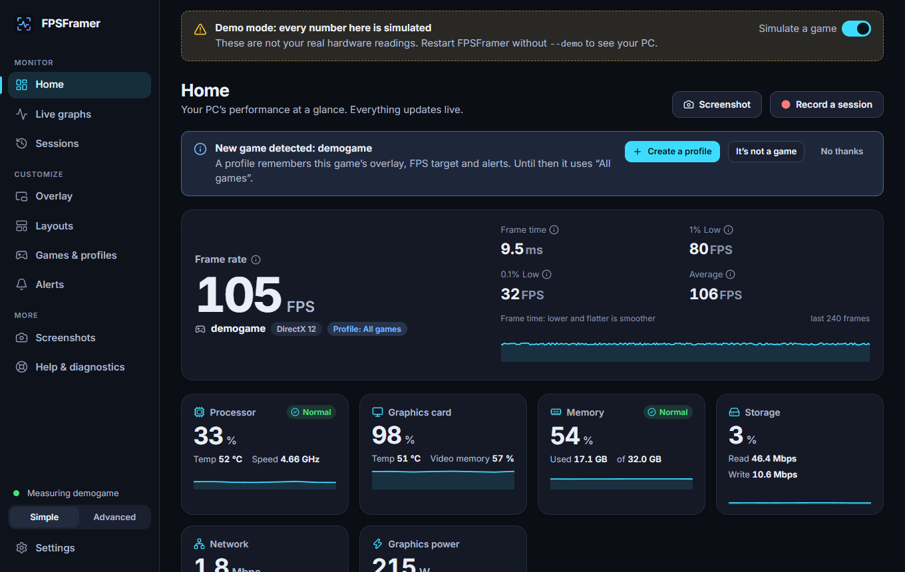
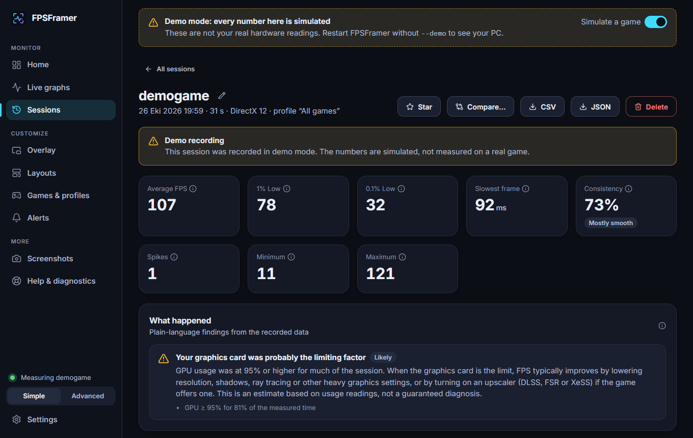
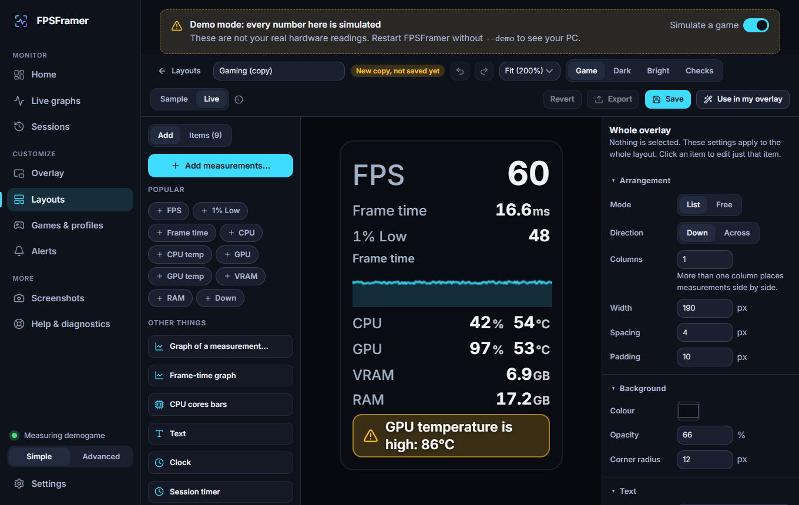

# FPSFramer

FPSFramer puts your frame rate and PC temperatures on screen while you play, records every game session, and
afterwards tells you in plain words what held the game back.



It is a small Windows app. It watches your games from the outside, the way Windows' own tools do, and never
touches the game itself. If it can't measure something on your PC, it says so and tells you why. It never makes
up a number.

## What you get

* **Live FPS.** Frame rate, frame time, average, 1% and 0.1% lows, and a frame time graph. Works for DirectX 9, 10, 11 and 12 games.
* **An overlay you can shape.** A transparent window above your game with the numbers you pick, in the corner you pick. Several ready made styles, or design your own in the visual editor. It never takes focus and your clicks go through to the game.
* **Hardware numbers.** CPU, GPU, memory, video memory, disk, network and battery. Temperatures, power and fan speed for NVIDIA cards. CPU temperature and fans if you run HWiNFO or LibreHardwareMonitor next to it.
* **Sessions.** Every game is recorded on its own. You get graphs, a list of spikes and drops, a "what limited performance" estimate (CPU or GPU), and you can compare two sessions or export them as CSV.
* **A profile per game.** FPSFramer notices which game is running and switches overlay, FPS target and alerts for you.
* **Alerts.** For example "tell me if the GPU stays above 85 degrees for ten seconds". Short spikes don't nag you.
* **Easy to read.** Dark, light and high contrast themes and adjustable text size. Every page is checked automatically for accessibility problems.

|  |  |
| --- | --- |
|  |  |
|  |  |

*These screenshots use demo mode (simulated numbers) over a frame from Counter-Strike 2.*

## Install

1. Download `FPSFramer_0.1.0_x64-setup.exe` from the [latest release](../../releases/latest).
2. Run it. It installs for your user account only and does not need administrator rights.
3. Windows may show a SmartScreen warning because the installer is not code signed yet. Choose "More info", then "Run anyway".

FPSFramer is for Windows 10 and 11. It uses the WebView2 component that Windows 11 already has; the installer brings its own setup for it if it is missing.

### One time step for FPS

Windows only lets administrators, and members of the "Performance Log Users" group, listen to frame events.
Everything else in the app works without this.

Open **Help, then FPS permission** and press **Allow FPS measurement**. Approve the Windows prompt, sign out of
Windows and back in, and you are done. If you would rather not do that, start FPSFramer with right click,
**Run as administrator**.

## Using it

Start a game in **Borderless** or **Windowed fullscreen** mode. FPSFramer finds the game within a second or two,
shows the overlay and starts recording. When you close the game, open **Sessions** to see how it went.

| Shortcut | What it does |
| --- | --- |
| `Ctrl+Shift+F9` | Show or hide the overlay |
| `Ctrl+Shift+F10` | Next overlay style |
| `Ctrl+Shift+F12` | Take a screenshot |
| `Ctrl+Shift+F6` | Start or stop recording by hand |
| `Ctrl+Shift+F7` | Move the overlay with the mouse |

You can change all of them in Settings. They work while a game is in front.

## Good to know

* **Exclusive fullscreen hides the overlay.** Windows draws those games straight to the screen, so no other window can appear above them. FPS and recording still work. Switch the game to Borderless to see the overlay.
* **Vulkan and OpenGL games get no FPS yet.** Their hardware numbers and the overlay still work.
* **Anti-cheat.** FPSFramer does not inject code, hook the game or read its memory. That is the same approach other monitoring tools take, but nobody can promise that a particular game's anti-cheat will accept an overlay. In competitive online games, check the game's rules and turn the overlay off with the hotkey if you are unsure.
* **CPU temperature needs a helper.** Windows keeps it behind a driver that normal programs can't load. Run [HWiNFO](https://www.hwinfo.com/) (with Shared Memory Support on) or [LibreHardwareMonitor](https://github.com/LibreHardwareMonitor/LibreHardwareMonitor) and FPSFramer picks the values up. **Help, then Missing sensors** walks you through it.
* **No FPS limiter.** Doing that properly means hooking the game. The app explains how to cap FPS in the game, in your graphics driver or with V-Sync.

More detail is in [docs/COMPATIBILITY.md](docs/COMPATIBILITY.md).

## Privacy

Everything stays on your PC. There are no accounts, no telemetry and no network access. FPSFramer only opens a web
page when you click a link in Help. Settings are in `%APPDATA%\FPSFramer`, sessions and logs in
`%LOCALAPPDATA%\FPSFramer`.

## How well tested is it?

It was written and tested on Linux first, then run on one real Windows 11 PC (Intel i5-12400F, GeForce RTX 3060 Ti,
two monitors) with Counter-Strike 2 and Rocket League. There, FPS capture, the overlay, shortcuts, hardware readings
and game detection work, and the FPS numbers matched another tool when compared by hand.

Not tested yet: exclusive fullscreen, AMD and Intel graphics sensors, laptops, more than one graphics card, and any
anti-cheat. [docs/TESTING.md](docs/TESTING.md) lists exactly what has and hasn't been checked, and a checklist if you
want to help.

If something looks wrong, open **Help, then Check my setup, then Copy report** and attach it to your bug report.
It contains no user names or personal paths.

## Build it yourself

You need Rust (stable, MSVC), Node 20 or newer and Git.

```powershell
git clone https://github.com/forderdev/FPSFramer
cd FPSFramer
npm --prefix ui ci
npm --prefix ui run build

# run it (debug build)
cargo run -p fpsframer-app --features custom-protocol

# build the installer
npm install --global @tauri-apps/cli@2
cd app\src-tauri
tauri build            # the installer ends up in target\release\bundle\nsis
```

Run the tests with `cargo test --workspace`, `npm --prefix ui test` and `npm --prefix ui run e2e`.

You can look around without Windows too: `FPSFRAMER_DEMO_GAME=1 cargo run -p fpsframer-devserver -- --demo --port 5757`
and open <http://127.0.0.1:5757>. Every simulated value is labelled "Demo".

### Where things live

```
crates/core       frame statistics, analysis, alerts, layouts, profiles, storage
crates/platform   Windows integration: sensors, frame capture (ETW), processes, screenshots
crates/engine     the runtime: sampler, game detection, sessions, JSON-RPC, diagnostics
app/src-tauri     the desktop shell: windows, overlay, tray, hotkeys, notifications
ui                React and TypeScript interface and the overlay renderer
docs              architecture, compatibility, layout format, testing
```

[Architecture](docs/ARCHITECTURE.md), [layout format](docs/LAYOUT_FORMAT.md), [third party software](THIRD_PARTY.md).

## Licence

MIT, see [LICENSE](LICENSE). FPSFramer is independent software and is not affiliated with any other FPS monitoring
product. The backdrop in the overlay previews is a Counter-Strike 2 frame owned by Valve and is not covered by this
licence (see [THIRD_PARTY.md](THIRD_PARTY.md)).
